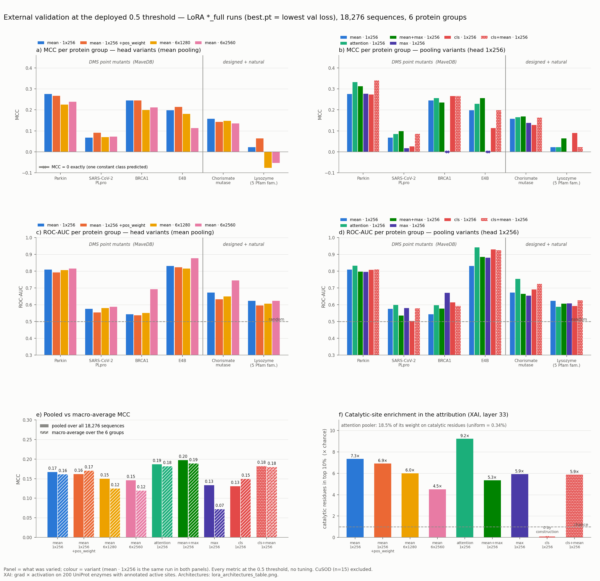
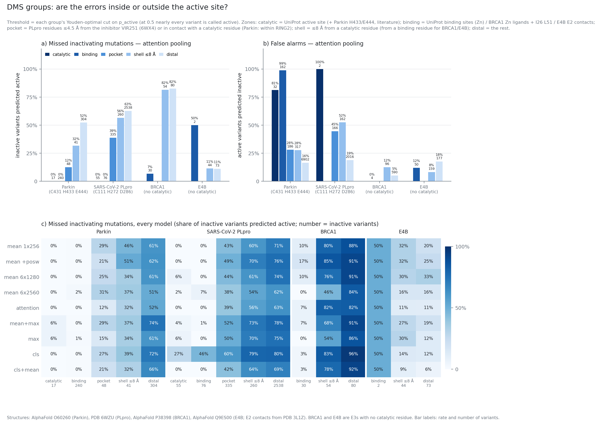

# Results — external validation

Two figures, both measured on proteins with **no detectable homology to the
training set** (MMseqs2, <30 % identity at 80 % coverage, bidirectional).

They answer two different questions:

1. `external_validation_results_full.png` — **does the classifier generalise?**
2. `dms_site_errors.png` — **where, structurally, does it fail?**

The short version: generalisation is poor, and the failures are not random —
they follow distance from the active site.

---

## The benchmark

| | |
|---|---|
| sequences | **18,291** (18,276 scored; CuSOD, n=15, excluded as too small) |
| class balance | 12,030 active / 6,261 inactive — **65.8 % active** |
| protein groups | 6 usable |
| sources | MaveDB (15,223) + an enzyme activity dataset (3,967) |
| dropped | 899 sequences over 1,022 residues (the whole Ube4b group) |

The groups fall into two kinds, and the distinction drives everything below:

- **DMS point mutants** — Parkin, SARS-CoV-2 PLpro, BRCA1, E4B. Thousands of
  single substitutions in *one* protein. Every sequence is ~99.7 % identical to
  every other.
- **Designed and natural variants** — chorismate mutase, lysozyme (5 Pfam
  families). Sequences that differ substantially from one another.

---

## 1. External validation



All nine `*_full` LoRA runs, scored at the **deployed 0.5 threshold** with no
tuning. Panels **a/c** vary the *head* (all mean pooling); panels **b/d** vary
the *pooling* (all 1×256 head). `mean · 1×256` is the same run in both, as the
anchor.

### The headline numbers

| run | pooled MCC | macro MCC | accuracy | balanced acc. |
|---|---|---|---|---|
| mean 1×256 | 0.167 | 0.161 | 0.674 | 0.526 |
| mean +pos_weight | 0.161 | 0.170 | 0.673 | 0.525 |
| mean 6×1280 | 0.150 | 0.124 | 0.670 | 0.520 |
| mean 6×2560 | 0.145 | 0.120 | 0.670 | 0.519 |
| attention | 0.186 | 0.181 | 0.678 | 0.534 |
| **mean+max** | **0.197** | **0.189** | 0.680 | 0.536 |
| max | 0.133 | 0.072 | 0.668 | 0.516 |
| cls | 0.131 | 0.149 | 0.668 | 0.516 |
| cls+mean | 0.182 | 0.179 | 0.677 | 0.530 |

**Read the accuracy column against the majority baseline of 0.658.** Always
predicting "active" scores 65.8 %; the best model scores 68.0 %. Recall is
0.993–0.998 for every run — they are calling almost everything active. Balanced
accuracy between 0.516 and 0.536 says the same thing: barely above chance.

Internal validation on homologous proteins gives MCC **0.955**. That gap is the
single most important number in this repository.

### What the panels show

**a, b — MCC per group.** Nothing clears 0.34. The `⊣` marks in panel b are runs
with MCC *exactly* 0: a constant class for every variant in that group. `max` and
`cls` do this on BRCA1 and E4B.

**c, d — ROC-AUC per group.** Consistently better than MCC, and this matters:
ROC-AUC is threshold-free. Parkin 0.81, E4B 0.83–0.94 — *the ranking carries real
signal while the 0.5 cut throws it away.* The models are badly calibrated, not
blind. PLpro (0.50–0.60) and BRCA1 for most runs are genuinely near chance.

**e — pooled vs macro-average MCC.** Close for every run, so no single large
group is carrying the pooled number.

**f — catalytic-site enrichment (XAI, layer 33).** How concentrated the
attribution is on annotated catalytic residues, relative to chance. Attention
pooling reaches **9.2×**, the highest of any run, and puts **18.5 %** of its
pooling weight on catalytic residues against a uniform expectation of **0.34 %**
— a ~54× concentration. `cls` is 0 by construction (no residue weighting exists
to measure).

**Note the disagreement between panels e and f.** Attention pooling wins
decisively on interpretability (9.2×) but `mean+max` wins on MCC (0.197 vs
0.186). Looking at the right residues and classifying correctly are not the same
achievement.

---

## 2. Where the errors are, structurally



For the four DMS groups, every variant is assigned to a zone by the position it
mutates, using the structure. **First match wins**, so the zones are disjoint:

| zone | definition |
|---|---|
| **catalytic** | UniProt `ACT_SITE` (+ Parkin H433/E444 from the literature) |
| **binding** | UniProt binding sites (Zn); BRCA1 Zn ligands + I26, L51; E4B E2-interface contacts |
| **pocket** | PLpro: ≤4.5 Å from inhibitor VIR251 (6WX4). Parkin: in contact with a catalytic residue, within RING2 |
| **shell** | ≤8 Å from a catalytic residue (from a binding residue for BRCA1/E4B) |
| **distal** | everything else |

Structures: AlphaFold O60260 (Parkin), PDB 6WZU (PLpro), AlphaFold P38398
(BRCA1), AlphaFold Q9ES00 (E4B, E2 contacts from PDB 3L1Z). Thresholds are
heavy-atom distances. Each group is scored at **its own Youden-optimal
threshold** — at 0.5 nearly every variant is called active, which would make the
panels uninformative.

### a — missed inactivating mutations (attention pooling)

Share of truly inactive variants the model called active:

| zone | Parkin | PLpro |
|---|---|---|
| catalytic | **0 %** (n=17) | **0 %** (n=55) |
| binding | **0 %** (n=240) | **0 %** (n=76) |
| pocket | 12 % (n=48) | 39 % (n=335) |
| shell ≤8 Å | 32 % (n=41) | 56 % (n=260) |
| distal | **52 %** (n=304) | **63 %** (n=2,538) |

**A clean monotonic gradient in both proteins.** Mutations at the catalytic
machinery are caught perfectly; mutations far from it are missed at close to the
rate you would get from a coin.

This is a mechanistic result, not a statistical artefact. The model has learned
what an active site looks like, and a mutation that destroys an enzyme *without*
touching the active site — typically by destabilising the fold — is invisible to
it.

**The two E3 ligases behave differently, and the README should say so.** BRCA1 is
~82 % missed in both shell and distal with no gradient between them, and E4B
*inverts* the pattern (11 % distal vs 50 % binding, though on only n=2). Neither
has a catalytic residue — they are ubiquitin ligases that position substrates
rather than performing chemistry — so "distance from the catalytic site" is not
defined for them, and the zones are measured from binding residues instead. The
gradient is a property of the two groups with real catalytic sites.

### b — false alarms

The mirror image, and the cost of the above: active variants called inactive.

On Parkin the model rejects **99 %** of active Zn-binding variants (n=162) and
**81 %** of active catalytic-triad variants (n=32). PLpro: 100 % of active
catalytic variants, though only n=2.

So the model is not detecting "this mutation is damaging" — it is detecting
**"this position is important"**, and then calling anything that touches it
inactive. Perfect recall at the active site and near-total loss of precision
there are the same behaviour seen from two sides.

### c — every model, not just one

The heatmap repeats panel a across all nine runs. **The gradient is present in
every one of them**, from `mean 1×256` to `cls+mean`. It is a property of the
approach, not of a particular pooling choice or head width.

Best distal performance: `attention` on Parkin (52 %) and `mean 6×2560` on PLpro
(62 %). Worst: `mean+max` on Parkin (74 %) — the same run that wins on overall
MCC.

---

## What this means in practice

**As a binary classifier at 0.5, it is not usable.** Accuracy 68 % against a
65.8 % majority baseline, recall 0.99, balanced accuracy 0.53.

**As a ranker, there is real signal** — ROC-AUC 0.81 on Parkin, 0.83–0.94 on E4B
— but it is thrown away by the fixed threshold. Any practical use needs a
threshold fitted per target, or a top-k ranking rather than a yes/no call.

**The blind spot is specific and characterisable.** Mutations distant from the
active site are missed roughly half to two-thirds of the time. Those are the ones
that most plausibly act by destabilising the fold, which suggests a stability
(ΔΔG) predictor as a complementary filter rather than a better activity model.
That hypothesis is **inferred from where the errors fall and has not been
tested** — the decisive experiment is whether the missed variants are in fact
destabilising.

---

## Reproducing

Source data and scripts live outside this repository, in `Active_or_not/external_benchmark/`:

```bash
python3 evaluate_external.py                 # → results_full/predictions_*.csv, metrics_*.csv
python3 dms_site_analysis.py                 # → results_full/dms_sites/region_metrics.csv
python3 dms_site_plot.py                     # → dms_site_errors.png
python3 plot_external_results_full.py        # → external_validation_results_full.png
```

Per-zone rates come from `results_full/dms_sites/region_metrics.csv`
(`miss_rate_youden`, `false_alarm_rate_youden`); the overall metrics from
`results_full/metrics_overall.csv`.
